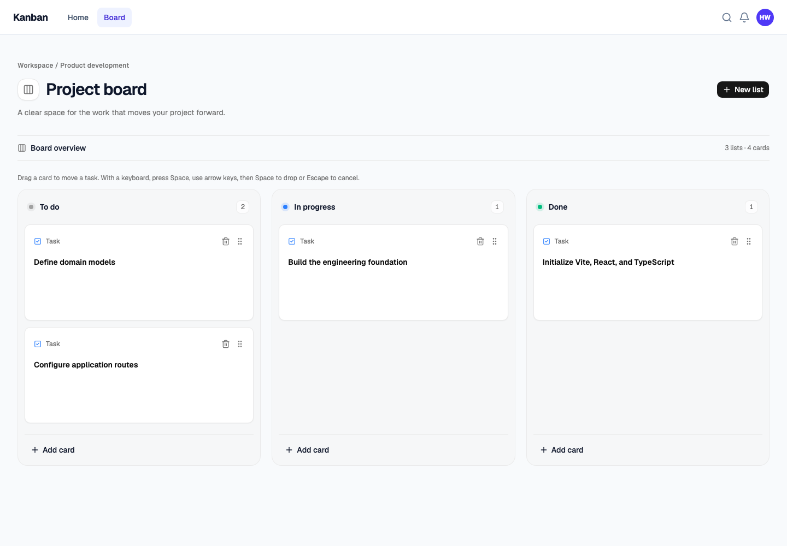

# Kanban

[](https://github.com/FoksWang/kanban/actions/workflows/ci.yml)

A focused, local-first project board built with React 19 and TypeScript. Create tasks, move them through your workflow, and return to the same board after a refresh.

**[Try the live demo](https://fokswang.github.io/kanban/#/board)** · [Watch the walkthrough](https://fokswang.github.io/kanban/demo/kanban-demo.mp4) · [Architecture](docs/architecture.md) · [Roadmap](docs/roadmap.md)



## Features

- Home and Board navigation with a shared application layout.
- Create named groups and task cards, with blank-title validation.
- Drag entire cards to reorder them or move them between groups, including empty groups.
- Keyboard drag and drop: focus a card, press Space, use arrow keys, and press Space to drop or Escape to cancel.
- Delete a task through a confirmation dialog; cancelling leaves the task intact.
- Automatic localStorage persistence of groups, tasks, ordering, and deletions.
- Horizontally scrollable groups, clear status indicators, and shadcn/ui dialogs and controls.

## Scope and engineering choices

This is a frontend portfolio project, not a hosted team-management service. It demonstrates component composition, shared TypeScript models, accessible interactions, immutable state transitions, browser persistence, automated tests, and delivery through CI.

- **State:** Zustand owns the board. Its `persist` middleware stores only `groups`, which contain `tasks`, under the `kanban-storage` key. Actions and in-progress drags are not persisted.
- **Drag and drop:** `@dnd-kit/core` provides `useDraggable`, `useDroppable`, sensors, collision detection, and a drag overlay. State changes only after a valid drop, so cancellation does not need a rollback.
- **UI:** Tailwind CSS v4 and shadcn/ui with a Neutral/Nova theme. Cards are separate reusable components.
- **Routing:** React Router uses normal browser routes locally and hash routes for the GitHub Pages subdirectory, so direct demo links and refreshes work without server rewrites.
- **Quality:** Vitest checks state transitions and hydration. Playwright exercises the production build in Chromium, including the GitHub Pages base path.

Other learning dependencies remain installed, including TanStack Query, React Hook Form, and Zod. The current board does not use a backend or server-state layer.

## Run locally

Use Node.js 24 (`nvm use` if you use nvm).

```bash
npm ci
npm run dev
```

Open the address printed by Vite, normally `http://localhost:5173`, and select **Board**.

## Checks and tests

```bash
npm run format:check
npm run lint
npm test
npx playwright install chromium
npm run test:e2e
```

- `npm test`: state tests for creation, ordering, cross-group moves, empty groups, invalid IDs, deletion, and persistence hydration.
- `npm run test:watch`: run the state tests in watch mode.
- `npm run test:e2e`: build and serve the application on an isolated port, then test real browser interactions. Each test uses a fresh browser context and does not modify your development board.
- `npx playwright show-report`: open the latest browser test report. Failures retain screenshots and traces.
- `npm run format`: format source files and sort Tailwind classes.

## Build and deployment

```bash
npm run build
npm run preview
```

For the GitHub Pages build:

```bash
VITE_BASE_PATH=/kanban/ npm run build
VITE_BASE_PATH=/kanban/ npm run preview
```

Open `/kanban/#/board` on the preview server. `VITE_BASE_PATH` configures the public asset path; no API keys or secrets are required.

The [CI and Pages workflow](.github/workflows/ci.yml) runs formatting, ESLint, state tests, Chromium tests, and the production build on pull requests and pushes to `main`. Only a passing `main` build is deployed to GitHub Pages. Failed browser tests are uploaded as diagnostic artifacts.

To reproduce this deployment in a fork, enable **Settings → Pages → Source → GitHub Actions**, update `VITE_BASE_PATH` in `playwright.config.ts` and the demo links for your repository name, then push to `main`.

## Project structure

```text
src/
  components/
    board/              Board, KanbanGroup, Task, and keyboard drag coordinates
    ui/                 shadcn/ui primitives
  pages/                Route-level components that connect the store to the UI
  router/               Home, Board, and fallback routes
  stores/useKanban.ts    Shared models, board actions, and persistence
tests/
  unit/                 State-transition and persistence tests
  e2e/                  Real browser interaction tests
.github/workflows/      Quality checks and Pages deployment
```

## Limitations

- Data belongs to one browser and origin. It is not synchronized across devices, users, tabs, or domains.
- Clearing site data removes the saved board. Browser storage is not a backup; private browsing or blocked/full storage can prevent persistence.
- No accounts, permissions, backend, collaborative editing, task editing, or deletion undo are implemented.
- Default status colors are tied to the seeded workflow groups; newly created groups use a neutral indicator.
- The header search and notification icons are visual placeholders.
- Automated browser coverage currently targets desktop Chromium; other browser and mobile combinations are not certified.

## Demo media

[Watch the 19-second walkthrough](https://fokswang.github.io/kanban/demo/kanban-demo.mp4) (MP4, approximately 1.4 MB; no audio).

[](https://fokswang.github.io/kanban/demo/kanban-demo.mp4)

The recording is included in the repository at [public/demo/kanban-demo.mp4](public/demo/kanban-demo.mp4) and served by GitHub Pages. Click the preview above to open it in your browser's video player.

The screenshot shows the running application. To refresh it, start the local preview and run `npm run screenshot`; set `DEMO_URL` to capture a different local or deployed URL.

## License

No open-source license has been selected. Public source visibility does not grant an additional license to reuse the code.
